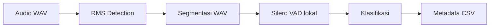

# PLN Radio Recorder V1 — RMS + Silero VAD lokal

Baca rekaman HT, simpan aktivitas audio berdasarkan RMS, kemudian klasifikasikan **WAV yang sudah selesai ditulis** memakai Silero VAD. Prioritasnya recall percakapan radio: indikasi lemah tetap masuk `uncertain` untuk ditinjau. Semua WAV tetap disimpan, termasuk `non-speech` dan hasil VAD yang gagal.



Algoritma RMS V1 tidak berubah: threshold default **-50 dBFS**, pre-buffer **1 detik**, silence timeout **10 detik**, blok **30 ms**. Seluruh proses RMS dan `finish()` selesai sebelum VAD dijalankan. Beep, buzz, dan noise masih dapat memicu RMS; VAD hanya menambahkan metadata, tanpa memfilter atau mengedit rekaman. Sample rate, jumlah kanal, dan WAV PCM 16-bit hasil RMS tetap mengikuti V1.

## Instalasi di Pop!_OS

Gunakan Python 3.10+ (diuji dengan Python 3.12), CPU x86-64 yang mendukung PyTorch, dan ruang untuk dependensi PyTorch. GPU tidak diperlukan.

```bash
sudo apt update
sudo apt install python3-venv python3-pip libsndfile1
python3 -m venv .venv
source .venv/bin/activate
python -m pip install --upgrade pip
# Pasang PyTorch CPU lebih dulu agar tidak mengunduh dependensi CUDA.
python -m pip install 'torch>=2.2,<3' --index-url https://download.pytorch.org/whl/cpu
python -m pip install -r requirements.txt
```

Dependensi tambahan: `torch` untuk inferensi CPU, `silero-vad==6.2.3` untuk model serta post-processing resmi, dan `scipy` untuk resampling salinan audio di RAM. I/O tetap memakai SoundFile, sehingga torchaudio, torchcodec, dan ONNX Runtime tidak diperlukan.

Model JIT tersedia di dalam paket `silero-vad`. Koneksi diperlukan ketika menginstal paket; setelah tersedia, pemrosesan berlangsung lokal, tanpa `torch.hub`, API berbayar, atau pengunduhan model saat program berjalan. Cek instalasi/model:

```bash
python -c 'from silero_vad import load_silero_vad; load_silero_vad(); print("Model lokal siap")'
```

Jika paket/model tidak tersedia atau inferensi gagal, segmentasi tetap menghasilkan WAV, CSV, dan grafik. Error ditulis ke terminal serta `vad_error`; status file menjadi `uncertain` dengan metrik kosong, bukan nilai nol yang menyiratkan non-speech.

## Menjalankan pipeline

Input WAV diproses langsung. Input M4A dikonversi otomatis melalui FFmpeg ke WAV
PCM 16-bit sementara, dengan sample rate dan jumlah kanal mengikuti sumber.
File asli tidak diubah; WAV sementara dibersihkan setelah selesai atau gagal.
Hasil segmen tetap disimpan di `data/processed/<sumber>_<timestamp>/`.
FFmpeg harus tersedia di PATH untuk M4A: `winget install Gyan.FFmpeg` di Windows,
atau `sudo apt install ffmpeg` di Pop!_OS/Ubuntu. Buka ulang terminal setelah instalasi.

Contoh Windows PowerShell (setelah dependensi terpasang):

```powershell
.\.venv\Scripts\Activate.ps1
python main.py "D:\MAGANG\PROJECT\STT\record\Recording1.m4a"
```

CLI V1 tetap berlaku:

```bash
python main.py data/baseline/ht.wav
python main.py data/baseline/ht.wav --threshold-db -60
python main.py data/baseline/ht.wav --output data/processed --prebuffer 1 --silence 10 --frame-ms 30
```

Output tersimpan di folder baru `data/processed/<sumber>_<timestamp>/`:

- `rekaman_0001.wav`, dst.: semua segmen RMS, tanpa perubahan oleh VAD.
- `segments.csv`: metadata waktu V1 ditambah klasifikasi dan error VAD.
- `aktivitas_suara.png`: grafik RMS V1.
- `vad_config.json`: parameter VAD untuk mengulang evaluasi.

Terminal menampilkan jumlah segmen serta ringkasan, misalnya `VAD: speech=4, non-speech=2, uncertain=6 (error=0)`.

Klasifikasi ulang **hasil segmentasi RMS yang sudah ada**, tanpa mengulang segmentasi:

```bash
python main.py --segments-dir data/processed/ht_20261022_092400
```

Mode ini membaca nama WAV dari `segments.csv` V1 dan memperbarui kolom VAD secara atomik. Kolom waktu dan metadata tambahan tetap dipertahankan. `vad_config.json` merekam konfigurasi evaluasi terbaru; simpan salinan CSV/konfigurasi jika ingin membandingkan beberapa percobaan. WAV tidak ditulis atau dihapus.

## Cara kerja VAD dan klasifikasi

Implementasi mengikuti [API resmi Silero](https://github.com/snakers4/silero-vad/tree/v6.2.3): `load_silero_vad(onnx=False)` dan `get_speech_timestamps_from_probs`. Ukuran window mengikuti [kode inferensi resmi](https://github.com/snakers4/silero-vad/blob/v6.2.3/src/silero_vad/utils_vad.py): **512 sampel pada 16 kHz = 32 ms**. Ukuran ini independen dari blok RMS 30 ms.

Setiap kanal dikonversi ke float32 dan di-resample ke 16 kHz **hanya di RAM**. Kanal diperiksa terpisah agar speech di satu sisi atau stereo berlawanan fase tidak hilang akibat downmix. State model di-reset sebelum setiap kanal/file. Window terakhir di-zero-pad untuk inferensi, tetapi padding tidak dihitung sebagai durasi audio atau bobot statistik. Satu model digunakan ulang untuk satu batch, secara serial.

Probabilitas setiap window adalah maksimum antar-kanal. Dari rangkaian ini dihitung:

| Kolom CSV tambahan | Makna |
|---|---|
| `speech_probability_max` | Probabilitas window tertinggi sepanjang file |
| `speech_probability_mean` | Rata-rata probabilitas berbobot jumlah sampel asli per window, termasuk pre-buffer dan ekor hening |
| `speech_duration_seconds` | Jumlah durasi rentang speech dari post-processing resmi Silero, tanpa speech padding |
| `vad_status` | `speech`, `non-speech`, atau `uncertain` |
| `vad_error` | Pesan kegagalan VAD; kosong jika berhasil |

Durasi rentang speech memakai hysteresis Silero: ambang keluar default `max(speech_threshold - 0.15, 0.01)` dan toleransi jeda singkat. Durasi ini bukan sekadar jumlah window di atas threshold. Hasil dibatasi panjang audio asli, tanpa menambahkan 30 ms padding speech bawaan Silero.

Aturan konservatif:

1. `speech`: terdapat setidaknya satu rentang speech yang lolos threshold dan durasi minimum Silero.
2. `non-speech`: tidak ada rentang speech, panjang audio minimal 0.25 detik, dan **seluruh** probabilitas window di semua kanal kurang dari 0.10.
3. `uncertain`: kondisi lainnya, termasuk indikasi lemah, spike singkat, cuplikan terlalu pendek tanpa rentang speech, atau kegagalan VAD.

Rata-rata/rasio speech tidak digunakan untuk menolak percakapan. Ucapan pendek dapat mempunyai mean rendah karena pre-buffer dan ekor hening 10 detik. Nilai probabilitas adalah skor model, bukan jaminan bahwa tidak ada manusia. Beep tertentu pun dapat memicu skor sedang/tinggi sehingga berstatus `uncertain` atau `speech`; ini sesuai prioritas recall.

## Parameter VAD

| Opsi CLI | Default | Pengaruh |
|---|---:|---|
| `--vad-speech-threshold` | 0.35 | Ambang memulai rentang speech; lebih rendah lebih sensitif |
| `--vad-non-speech-threshold` | 0.10 | Hanya max **di bawah** nilai ini boleh `non-speech`; lebih rendah memperluas zona `uncertain` |
| `--vad-min-speech-ms` | 100 | Rentang yang lebih pendek dibuang oleh post-processing Silero; spike tetap dapat menjadi `uncertain` |
| `--vad-min-silence-ms` | 100 | Jeda pemisah rentang speech VAD; **bukan** silence timeout RMS |
| `--vad-min-analysis-seconds` | 0.25 | Panjang minimum untuk keputusan `non-speech` |

Syarat: `0 <= non_speech_threshold < speech_threshold <= 1`, durasi speech/silence tidak negatif, dan minimum analisis positif. Contoh lebih sensitif terhadap percakapan radio lemah:

```bash
python main.py --segments-dir data/processed/ht_20261022_092400 \
  --vad-speech-threshold 0.25 \
  --vad-non-speech-threshold 0.05 \
  --vad-min-speech-ms 64
```

Parameter juga tersedia sebagai `VADConfig` di Python. Ini titik awal evaluasi, belum threshold terkalibrasi untuk semua jenis HT.

## Modul yang dapat digunakan ulang

```python
from pathlib import Path
from radio_recorder.vad import SileroVAD, VADConfig

vad = SileroVAD(VADConfig(speech_threshold=0.35))
result = vad.analyze_file(Path("data/processed/run/rekaman_0001.wav"))
print(result.vad_status, result.speech_duration_seconds, result.vad_error)
```

Input harus WAV yang sudah ditutup. `analyze_file()` mengembalikan `VADResult`; error per file ditangkap sebagai `uncertain`. Modul tidak bergantung pada recorder atau transkripsi sehingga kelak dapat dipakai sebelum Whisper. Tahap ini tidak menambahkan Whisper, database, UI, atau perekaman USB.

## Pengujian dan evaluasi

```bash
python -m pip install pytest
python -m pytest -q
```

Tes mencakup klasifikasi tiga status, spike speech, ucapan pendek dengan ekor hening 10 detik, indikasi speech lemah, window parsial, stereo berlawanan fase, resampling 8/16/44.1/48 kHz, model gagal dimuat, inferensi gagal, file kosong/hilang, CSV V1, CLI lama, dan kesamaan byte WAV serta waktu RMS pada setiap hasil VAD. Tes beep 2 kHz, buzz 100 Hz, dan noise memakai **model Silero asli setelah segmentasi RMS**. Beep 1 kHz yang memicu indikasi singkat tetap diuji sebagai `uncertain`. Dua tes tambahan memakai sampel radio lokal dengan noise SNR 0/-5 dB; tes ini dilewati jika sampel proyek tidak tersedia. Tidak ada model uji yang perlu diunduh saat tes.

Untuk mengevaluasi akurasi pada radio sebenarnya:

1. Dengarkan dan beri label manual setiap segmen: ada percakapan, hanya noise/beep, atau belum jelas. Utamakan pengecekan **semua** hasil `non-speech`, termasuk percakapan singkat/lemah dan noise berat.
2. Bandingkan label dengan `segments.csv`. Jangan menganggap output model sebagai ground truth. Catat percakapan yang salah menjadi `non-speech`, juga proporsi `uncertain` dan noise yang masuk `speech`.
3. Ukur recall perlindungan percakapan: jumlah file berlabel percakapan yang berstatus `speech` **atau `uncertain`**, dibagi semua file berlabel percakapan. Catat pula recall `speech` saja agar zona `uncertain` tidak menyamarkan kemampuan deteksi.
4. Jika percakapan menjadi `non-speech`, turunkan `--vad-non-speech-threshold`. Untuk meningkatkan rentang speech yang terdeteksi, coba turunkan `--vad-speech-threshold` dan/atau `--vad-min-speech-ms`, lalu evaluasi ulang set berlabel yang sama. Pertahankan parameter RMS ketika membandingkan VAD.
5. Simpan CSV, konfigurasi, dan label per eksperimen. Semua WAV, termasuk `non-speech`, tetap menjadi arsip dan dapat diperiksa atau diproses ulang.

Hasil pengujian awal pada segmen proyek ada di [VAD_EVALUATION.md](VAD_EVALUATION.md). Recall lapangan belum dapat dihitung tanpa label manusia. RMS juga tetap perlu dievaluasi terhadap WAV sumber karena VAD tidak bisa mendeteksi percakapan yang tidak pernah tersimpan sebagai segmen.

## Berkas utama

| Berkas | Peran |
|---|---|
| `radio_recorder/detector.py`, `segmenter.py` | Deteksi dan segmentasi RMS V1, tidak diubah |
| `radio_recorder/vad.py` | Model lokal, probabilitas, durasi speech, klasifikasi, isolasi error, ringkasan |
| `radio_recorder/report.py` | CSV dengan kolom VAD dan pembaruan metadata CSV V1 |
| `main.py` | Integrasi setelah `finish()`, parameter CLI dan mode evaluasi ulang |
| `tests/test_recorder.py`, `tests/test_vad.py` | Regresi RMS dan pengujian VAD/pipeline |
| `requirements.txt` | Dependensi runtime |
